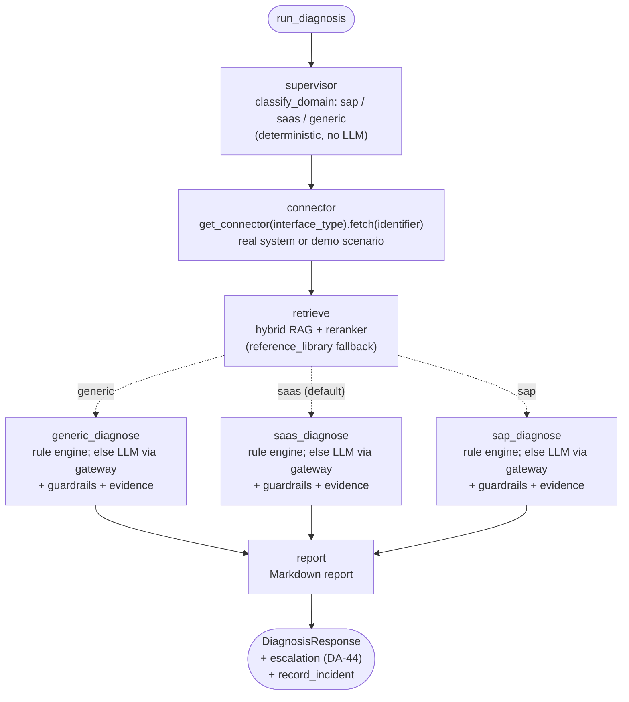

# Copilot Platform

Plataforma compartilhada de diagnóstico para IIC e FISC.
Core Python, core-ui e operações têm versões independentes.

| Componente | Versão | Conteúdo |
|---|---|---|
| copilot-core | 1.5.0 | SDK, grafo, gateway, RAG, evidências, auth e conectores |
| @copilot/core-ui | 0.1.1 | ESM, tipos e CSS compartilhados |
| copilot-operations | 1.0.2 | Migrations e dashboards, candidato para core 1.5.0 |

Os produtos permanecem em repositórios próprios:
[IIC](https://github.com/marcos-slima/integration-incident-copilot) e
[FISC](https://github.com/marcos-slima/fiscal-incident-support-copilot).
Este repositório não é uma aplicação de produto nem um serviço remoto obrigatório.

Comece pelo [índice documental](docs/README.md).

Veja [arquitetura](docs/PLATFORM.md), [releases](docs/RELEASES.md),
[propriedade](docs/OWNERSHIP.md) e [operação](operations/README.md).

## Desenvolvimento

~~~bash
uv sync --all-packages --group dev --locked
npm ci
uv run python scripts/quality_gate.py
uv run pytest tests/ -m "not integration" -q --cov=app --cov-fail-under=80
npm test
~~~

## Grafo compartilhado

<!-- grafo-gerado:inicio (scripts/graph_diagram.py --write; nao editar a mao) -->

**Default: GRAPH_RAG_ENABLED=false**

<!-- grafo-gerado:fim -->
